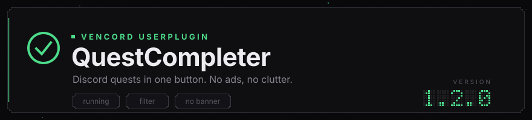
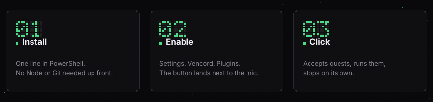

<div align="center">



<p>A <a href="https://github.com/Vendicated/Vencord">Vencord</a> plugin: runs Discord quests from one button, cleans up the quest list and removes the ad banner.</p>

<p>


<a href="https://www.virustotal.com/gui/file/f82452a0e8bd8a13e4b93879657f268f9d2793bb072b215f36ad096a9b1e4913/detection"></a>
</p>

<p>English · <a href="README.ru.md">Русский</a> · <a href="README.uk.md">Українська</a></p>

</div>

## Install



Open PowerShell and paste one line. The installer shows a menu: install, update, remove.

```powershell
$s="$env:TEMP\qc-setup.ps1"; irm https://raw.githubusercontent.com/flexeykinDev/vencord-quest-completer/main/setup.ps1 -OutFile $s; powershell -NoProfile -ExecutionPolicy Bypass -File $s
```

You need nothing installed up front, not even Git. Whatever is missing for the build, the script offers to fetch through `winget`, which ships with Windows 11. It asks about each tool separately and never installs anything silently. It finds your Vencord folder on its own too.

### Without the command line

Grab the archive from [releases](https://github.com/flexeykinDev/vencord-quest-completer/releases/latest), unpack it and double click:

| File | What it does |
| --- | --- |
| `install.cmd` | installs right away |
| `uninstall.cmd` | removes right away |
| `setup.cmd` | shows the menu |

## Remove

Same installer, option 3 in the menu. Or straight away:

```powershell
$s="$env:TEMP\qc-setup.ps1"; irm https://raw.githubusercontent.com/flexeykinDev/vencord-quest-completer/main/setup.ps1 -OutFile $s; powershell -NoProfile -ExecutionPolicy Bypass -File $s -Action Uninstall
```

It asks how deep to cut:

| Option | What goes |
| --- | --- |
| 1 | the plugin only, Vencord and your other plugins stay |
| 2 | the plugin, plus Vencord is unhooked and Discord goes back to stock |
| 3 | everything, including the Vencord source folder and the build tools |

Every destructive step is confirmed separately.

## About running scripts

Windows blocks downloaded scripts by default. That is why both the command above and `setup.cmd` pass `-ExecutionPolicy Bypass`: it applies to that one process only. You do not need to change your machine's policy with `Set-ExecutionPolicy`.

Once the script is done, three steps are left in Discord itself:

1. Ctrl+R
2. Settings, Vencord, Plugins, enable `QuestCompleter`
3. Ctrl+R again

The button shows up in the account panel at the bottom left, next to the mic.

<details>
<summary>Manual install</summary>

```powershell
winget install OpenJS.NodeJS.LTS
winget install Git.Git
```

Close and reopen PowerShell, otherwise `node` and `git` are not visible yet.

```powershell
npm i -g pnpm
git clone https://github.com/Vendicated/Vencord
cd Vencord
pnpm i
git clone https://github.com/flexeykinDev/vencord-quest-completer src\userplugins\QuestCompleter
pnpm build
pnpm inject
```

There is no `src/userplugins` folder after cloning, because it sits in Vencord's own `.gitignore`. The command above creates it.

`setup.ps1 -Action Manual` prints the same thing.

</details>

## What it does

**Runs quests.** A button next to the mic. The icon shows the state, the tooltip shows progress, clicking again stops it.

| Task type | How it is done |
| --- | --- |
| Watch a video | sends watch progress, counting real time |
| Play on desktop | temporarily swaps the list of running games |
| Stream on desktop | temporarily swaps the stream metadata |
| Play an activity | sends a heartbeat into a voice channel |
| Achievement in an activity | goes through the activity's authorization, see below |

The platform is picked automatically. Many quests carry several tasks at once, for example `PLAY_ON_DESKTOP`, `PLAY_ON_XBOX` and `PLAY_ON_PLAYSTATION`, and the "Select a platform" dropdown decides which one you do. The plugin always takes the desktop one: console tasks are not in its list, and it could not fake a console session anyway. A quest with no supported task is skipped.

Requests are spaced with randomized delays, and quests are separated by a pause of 15 to 45 seconds. Every swapped method is put back in a `finally`: on success, on error, when you press stop, and when the plugin is disabled.

Video progress is counted from the moment the quest was accepted and cannot run more than ten seconds ahead of real time. A quest accepted an hour ago will not finish instantly.

**Accepts quests.** By default the plugin only sees quests you have already accepted and quietly skips the rest. The "Accept every available quest first" setting takes that chore off you: the button accepts everything available, then starts running. On a 429 it waits exactly as long as Discord asks.

**Cleans the list.** Only the states you care about stay on the Quests page.

**Removes the banner.** The ad block at the top and the row of cards under it.

## The button

Hover it and the tooltip tells you what is happening right now: which quest is running and roughly how much is left, for example "quest 2 of 7, about 14 min left".

Right click opens a menu so you do not have to walk into settings for one checkbox:

| Item | Why |
| --- | --- |
| Accept quests first | the same setting, toggled in place |
| Achievement quests | same |
| Refresh quest list | asks Discord to send the list again |

That last one is useful on its own: Discord normally refreshes the list every couple of hours, and otherwise the only way to see new quests is restarting the client.

The counter is honest. Quests there is no point starting do not go into it: achievement quests while the bypass is off, desktop tasks in the browser build, and anything that already failed this session. Promising eleven and silently doing eight would be lying in the UI.

If the plugin can read the reward size, it shows that too: "Running 7 quests, 3400 Orbs".

## Language

The plugin speaks your client's language: English, Russian, Ukrainian. It reads the language from Discord's own settings, so there is nothing to pick. Anything else falls back to English.

Settings, notifications, the button tooltip and error messages are translated. Console output in DevTools stays in Russian: that is diagnostics, not interface.

## Achievement quests

A separate story, and therefore a separate setting, off by default.

These quests do not fall for heartbeat spoofing: Discord expects the activity itself to confirm progress. There is exactly one way around that, going through a real OAuth authorization, which **actually grants the game's app access to your account** with the scope `identify applications.commands applications.entitlements`.

That is fundamentally different from the other tasks. There, a counter is faked. Here, access is granted.

What is done to keep the risk down:

- the setting is off by default and the warning is written into its description
- the granted access is revoked in a `finally`, so both on error and when you press stop
- progress moves at a realistic pace instead of jumping to the target
- the `discordsays` requests live in `native.ts` and are limited to two functions: no account token, no captcha, no file access, and the host and referrer are checked before every call

After the first run, open Discord Settings, Authorized Apps, and check that it is empty.

## Settings

| Setting | Default | What it does |
| --- | --- | --- |
| Check GitHub for updates | on | once every six hours, one notification |
| Accept every available quest first | off | accepts the unaccepted ones, then runs them |
| Achievement quests | off | OAuth bypass, see the section above |
| Claim the reward after a quest | off | tries to claim, asks you to do it by hand on a captcha |
| Filter the quest list | on | master switch for the whole filter |
| Can be accepted | on | not accepted yet |
| In progress | on | accepted, progress is moving |
| Claim reward | on | finished, reward not taken |
| Finished | off | reward already claimed |
| Expired | off | out of time |
| Only Orb rewards | off | hides everything that does not pay in Orbs |
| Hide the top banner | on | the banner and the card row under it |

By default exactly three states stay in the list: can accept, in progress, claim reward. The "Claimed Quests" tab works as usual, the filter does not touch it.

## How it works

The plugin does not hide finished markup. It hooks the places where Discord makes the decision itself.

| What | Where it hooks |
| --- | --- |
| List filter | the hook that builds the quest array for the page. One source for both the sections and the flat list |
| Ads | the ad store's method. We return `null`, which is a normal value there meaning "no ad was matched" |
| Banner | the banner component itself. With no ad, Discord draws its own Orbs promo in that spot |
| Banner wrapper | the only place with CSS. The wrapper is drawn by a separate component with a loading skeleton, and without this the page keeps an empty rectangle |
| Button | the account panel, the same spot the stock GameActivityToggle uses |
| Achievements | `native.ts` in the main process: the renderer's CSP blocks requests to `discordsays` |

The quests store is not in the Flux registry under the expected name, so it is found by its set of methods instead.

## When it breaks

The plugin leans on Discord's internals, and those change with updates.

| Symptom | What to do |
| --- | --- |
| The button is gone from the panel | a patch did not apply, look for Vencord's failed patch message in the console |
| A "could not find QuestsStore" notification | store signatures changed, fix in `stores.ts` |
| The banner is back | Discord moved, the patch needs a new anchor |
| Vencord disappeared after a Discord update | the hook came off, nothing to do with the plugin: `pnpm inject` |
| "Achievement quest skipped" | the bypass is off, turn it on and read the section above |
| Achievement quests do nothing | `native.ts` needs a full Discord restart, Ctrl+R is not enough |

Logs go to the DevTools console with the `[Vencord] [QuestCompleter]` prefix:

```
[Vencord] [QuestCompleter] Найден QuestsStore
[Vencord] [QuestCompleter] Начинаю квест: Name (PLAY_ON_DESKTOP)
[Vencord] [QuestCompleter] Прогресс: 119/900
```

<details>
<summary>Development</summary>

```powershell
pnpm watch        # rebuild on every save
pnpm test:ts      # typecheck, esbuild does not do it
npx eslint src/userplugins/QuestCompleter --ext .ts,.tsx,.mjs
```

Ctrl+R in Discord after every rebuild.

| File | What is inside |
| --- | --- |
| `index.tsx` | the plugin definition and every patch |
| `types.ts` | quest types, `taskConfig` and `taskConfigV2` handling |
| `stores.ts` | finding Discord stores by their set of methods |
| `runner.ts` | running quests, run state, cancellation |
| `filter.ts` | quest state and the list filter |
| `QuestButton.tsx` | the account panel button and its right click menu |
| `i18n.ts` | interface strings in three languages |
| `update.ts` | the GitHub update check |
| `native.ts` | two `discordsays` requests from the main process |
| `hideHero.css` | hiding the banner wrapper |
| `setup.ps1` | the installer |
| `assets/generate.mjs` | the generator for the images in these READMEs |

Images are not edited by hand. Change a color or a string in the generator and rebuild:

```powershell
node assets\generate.mjs assets
```

After changes to `native.ts`, Ctrl+R is not enough: the main process reads it at startup, so Discord needs a full restart.

**Debugging patches.** Build with `pnpm build --dev`. Only a dev build makes Vencord fill in the `SYM_PATCHED_BY` and `SYM_PATCHED_SOURCE` symbols, and then `Vencord.WebpackPatcher` shows which modules are patched and what the patched code looks like:

```js
const { SYM_PATCHED_BY, SYM_PATCHED_SOURCE } = Vencord.WebpackPatcher;
const m = Vencord.Webpack.wreq.m;
Object.keys(m).filter(id => m[id][SYM_PATCHED_BY]?.has?.("QuestCompleter"));
```

In a normal build those symbols are empty, so checking through them proves nothing. Also note that a module factory's `toString()` always returns the original source, never the patched one: Vencord hides that on purpose.

Patches are applied lazily, the first time a module loads. A message at startup about an unapplied patch is normal for a page you have not opened yet.

</details>

## Verifying the files

The script from the release is downloaded off the internet and installs things, so wanting to check it is reasonable. Below are the hashes for version 1.2.0 and links to VirusTotal.

| File | SHA-256 | Detections |
| --- | --- | --- |
| `setup.ps1` | `f82452a0…e4913` | [**0 of 62**](https://www.virustotal.com/gui/file/f82452a0e8bd8a13e4b93879657f268f9d2793bb072b215f36ad096a9b1e4913/detection) |
| `setup.cmd` | `3adb96ca…b87df7` | [**0 of 61**](https://www.virustotal.com/gui/file/3adb96cac1a8d18b86210fa9bebd49dfb39c4fa23a823805c3a557db79b87df7/detection) |
| `install.cmd` | `905af63d…0d0631` | [**0 of 60**](https://www.virustotal.com/gui/file/905af63d61fa85dd63a435b0c58a77f49c1a0e6ce71c4bf9b80c06a8260d0631/detection) |
| `uninstall.cmd` | `03db09a1…88db1f` | [**0 of 61**](https://www.virustotal.com/gui/file/03db09a11f612170ebd64cba36461262fb9f182e4d5cb76d22a7ddfe5d88db1f/detection) |
| `QuestCompleter-1.2.0.zip` | on the [release page](https://github.com/flexeykinDev/vencord-quest-completer/releases/latest) | see the release |

The three `.cmd` files have not changed since 1.0.0, so their checks from 19 September 2026 still hold: nothing was flagged. Different denominators are normal, VirusTotal runs a different set of engines depending on file type.

The installer has not changed since 1.1.0 either, `setup.ps1` has the same hash. The only new file in 1.2.0 is the archive, since the changes were in the plugin code.

The archive hash lives on the release page rather than here: the archive contains this README, and a file cannot carry its own hash.

This table describes the files **from the release**. The install command pulls `setup.ps1` from the `main` branch, which moves ahead between releases, so its hash may not match. Hashes are worth comparing against what you downloaded from the release page.

Check a downloaded file against the list:

```powershell
Get-FileHash .\setup.ps1 -Algorithm SHA256
```

If the hash matches, the file is exactly the one in the release.

### What the installer does

All of the code is open and reads in ten minutes, but in short it:

- downloads Vencord and this plugin with plain `git clone`
- installs dependencies with `pnpm` and builds the project
- runs the **official Vencord installer**, which is what hooks the build into Discord
- fetches Node.js and Git through `winget` with your consent
- remembers the Vencord path in `%APPDATA%\QuestCompleter`

It does not ask for administrator rights, does not write to the registry, does not touch startup entries, and only talks to GitHub and the winget repositories.

### Why antivirus software may complain

Heuristics dislike the genre itself: a PowerShell script that downloads files, installs programs and changes the contents of an installed application. Formally that is what plenty of harmless installers do.

On top of that, Vencord modifies Discord's files, which is its job as a client mod. Some security products treat modifying someone else's application as suspicious on its own, regardless of what the mod actually does.

If your antivirus flagged something, compare the detection name against things like `Trojan`, `Miner` or `Stealer`, and check the hash above. Hits on `PowerShell/Agent`, `HackTool`, `Riskware` and similar are about the genre, not about a specific threat.

## Disclaimer

This plugin fakes quest progress. That breaks Discord's terms of service, and rewards are sometimes revoked. Achievement quests additionally grant the game's app access to your account over OAuth, which is why they are off by default. Use at your own risk.
