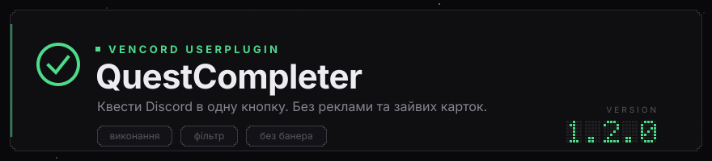
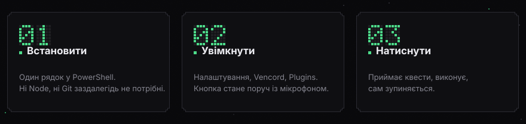

<div align="center">



<p>Плагін для <a href="https://github.com/Vendicated/Vencord">Vencord</a>: виконує квести Discord однією кнопкою, чистить список квестів і прибирає рекламний банер.</p>

<p>


<a href="https://www.virustotal.com/gui/file/f82452a0e8bd8a13e4b93879657f268f9d2793bb072b215f36ad096a9b1e4913/detection"></a>
</p>

<p><a href="README.md">English</a> · <a href="README.ru.md">Русский</a> · Українська</p>

</div>

## Встановлення



Відкрий PowerShell і встав один рядок. Інсталятор покаже меню: встановити, оновити, видалити.

```powershell
$s="$env:TEMP\qc-setup.ps1"; irm https://raw.githubusercontent.com/flexeykinDev/vencord-quest-completer/main/setup.ps1 -OutFile $s; powershell -NoProfile -ExecutionPolicy Bypass -File $s
```

Нічого встановлювати заздалегідь не треба, навіть Git. Чого бракує для збірки, скрипт запропонує доставити через `winget`, він вбудований у Windows 11. Про кожен інструмент питає окремо й нічого не ставить мовчки. Теку Vencord теж знаходить сам.

### Без командного рядка

У [релізах](https://github.com/flexeykinDev/vencord-quest-completer/releases/latest) лежить архів. Завантаж, розпакуй і запусти подвійним кліком:

| Файл | Що робить |
| --- | --- |
| `install.cmd` | одразу встановлює |
| `uninstall.cmd` | одразу видаляє |
| `setup.cmd` | показує меню |

## Видалення

Тим самим інсталятором, пункт 3 у меню. Або одразу:

```powershell
$s="$env:TEMP\qc-setup.ps1"; irm https://raw.githubusercontent.com/flexeykinDev/vencord-quest-completer/main/setup.ps1 -OutFile $s; powershell -NoProfile -ExecutionPolicy Bypass -File $s -Action Uninstall
```

Запитає, наскільки глибоко різати:

| Варіант | Що прибирає |
| --- | --- |
| 1 | лише плагін, Vencord та інші плагіни лишаються |
| 2 | плагін і Vencord з Discord, клієнт повертається до початкового вигляду |
| 3 | усе, разом із текою вихідників та інструментами збірки |

Кожен руйнівний крок підтверджується окремо.

## Про запуск скриптів

Типово Windows не дає запускати завантажені скрипти. Саме тому і в команді вище, і в `setup.cmd` стоїть `-ExecutionPolicy Bypass`: він діє лише на один запущений процес. Змінювати політику машини через `Set-ExecutionPolicy` не потрібно.

Коли скрипт завершить роботу, лишиться три кроки в самому Discord:

1. Ctrl+R
2. Налаштування, Vencord, Plugins, увімкнути `QuestCompleter`
3. Ще раз Ctrl+R

Кнопка з'явиться в панелі акаунта внизу ліворуч, поруч із мікрофоном.

<details>
<summary>Встановлення вручну</summary>

```powershell
winget install OpenJS.NodeJS.LTS
winget install Git.Git
```

Закрий і знову відкрий PowerShell, інакше `node` і `git` ще не будуть видимі.

```powershell
npm i -g pnpm
git clone https://github.com/Vendicated/Vencord
cd Vencord
pnpm i
git clone https://github.com/flexeykinDev/vencord-quest-completer src\userplugins\QuestCompleter
pnpm build
pnpm inject
```

Теки `src/userplugins` після клонування немає, бо вона в `.gitignore` самого Vencord. Її створює ця команда.

Те саме надрукує `setup.ps1 -Action Manual`.

</details>

## Що вміє

**Виконує квести.** Кнопка поруч із мікрофоном. Іконка показує стан, у підказці видно прогрес, повторне натискання зупиняє.

| Тип завдання | Як виконується |
| --- | --- |
| Подивитися відео | надсилає прогрес перегляду, рахуючи реальний час |
| Пограти на десктопі | тимчасово підміняє список запущених ігор |
| Постримити | тимчасово підміняє метадані стріму |
| Зіграти активність | надсилає heartbeat у голосовий канал |
| Досягнення в активності | проходить авторизацію активності, див. нижче |

Платформа обирається сама. У багатьох квестів у конфігу лежить одразу кілька завдань, наприклад `PLAY_ON_DESKTOP`, `PLAY_ON_XBOX` та `PLAY_ON_PLAYSTATION`, і випадний список «Select a platform» вирішує, яке саме виконувати. Плагін завжди бере десктопне: консольних завдань у його списку немає, та й підробити гру на приставці він однаково не зміг би. Квест без жодного підтримуваного завдання просто пропускається.

Між запитами стоять випадкові затримки, між квестами пауза від 15 до 45 секунд. Усі підмінені методи повертаються на місце у `finally`: і за успіху, і за помилки, і коли ти натиснув «стоп», і коли плагін вимкнено.

Прогрес перегляду відео рахується від моменту прийняття квеста й не може випередити реальний час більш ніж на десять секунд. Квест, прийнятий годину тому, не дорахується миттєво.

**Приймає квести.** Типово плагін бачить лише прийняті квести, а решту мовчки пропускає. Налаштування «Спершу приймати всі доступні квести» знімає цей клопіт із тебе: кнопка спершу прийме все доступне, а потім піде виконувати. На відповідь 429 плагін чекає рівно стільки, скільки просить Discord.

**Чистить список.** На сторінці Quests лишаються тільки потрібні стани.

**Прибирає банер.** Рекламний блок угорі та ряд карток під ним.

## Кнопка

Наведи, і в підказці буде видно, що відбувається просто зараз: який квест за рахунком іде та скільки приблизно лишилось, наприклад «квест 2 з 7, лишилось приблизно 14 хв».

Правий клік відкриває меню, щоб не ходити в налаштування через одну галочку:

| Пункт | Навіщо |
| --- | --- |
| Спершу приймати квести | те саме налаштування, перемикається на місці |
| Квести на досягнення | так само |
| Оновити список квестів | просить Discord надіслати список заново |

Останній пункт корисний і сам собою: зазвичай Discord оновлює список раз на пару годин, і дочекатися нових квестів інакше можна лише перезапуском клієнта.

Лічильник у сповіщенні чесний. Квести, за які зараз немає сенсу братися, до нього не потрапляють: досягнення за вимкненого обходу, десктопні завдання у браузерній версії та ті, що вже впали в цьому запуску. Обіцяти одинадцять і мовчки пропустити три було б брехнею в інтерфейсі.

Якщо плагін знає розмір нагороди, він покаже і її: «Запускаю квести: 7, орбів: 3400».

## Мова

Плагін говорить мовою клієнта: українською, російською, англійською. Мова береться з налаштувань самого Discord, окремо обирати нічого не треба. Для решти мов показується англійська.

Перекладаються налаштування, сповіщення, підказка на кнопці та тексти помилок. Повідомлення в консолі DevTools лишаються російською: це діагностика, а не інтерфейс.

## Квести на досягнення

Окрема історія, тому й окреме налаштування, вимкнене типово.

Такі квести не ведуться на підробку heartbeat: Discord чекає, що прогрес підтвердить сама активність. Обійти це можна лише одним способом, пройти справжню авторизацію OAuth, тобто **реально надати застосунку гри доступ до твого акаунта** зі scope `identify applications.commands applications.entitlements`.

Це принципово інше, ніж решта завдань. Там підробляється лічильник, тут надається доступ.

Що зроблено, щоб знизити ризик:

- налаштування вимкнене типово, попередження написане просто в його описі
- наданий доступ відкликається у `finally`, тобто і за помилки, і коли ти натиснув «стоп»
- прогрес іде в реальному темпі, а не стрибає одразу до цілі
- запити до `discordsays` живуть у `native.ts` і обмежені двома функціями: ні токена акаунта, ні капчі, ні роботи з файлами, а хост і referrer перевіряються перед кожним викликом

Після першого запуску зазирни в Налаштування Discord, Авторизовані застосунки, і переконайся, що там порожньо.

## Налаштування

| Налаштування | Типово | Що робить |
| --- | --- | --- |
| Перевіряти оновлення на GitHub | увімк | раз на шість годин, одне сповіщення |
| Спершу приймати всі доступні квести | вимк | приймає неприйняті, потім виконує |
| Квести на досягнення | вимк | обхід через OAuth, див. розділ вище |
| Забирати нагороду після виконання | вимк | пробує забрати, за капчі просить зробити це вручну |
| Фільтрувати список квестів | увімк | загальний вимикач для всього фільтра |
| Можна прийняти | увімк | ще не прийняті |
| У процесі | увімк | прийняті, прогрес іде |
| Забрати нагороду | увімк | виконані, нагороду не забрано |
| Завершені | вимк | нагороду вже отримано |
| Застарілі | вимк | строк вийшов |
| Лише нагорода в орбах | вимк | ховає все, де нагорода не в орбах |
| Ховати банер угорі | увімк | банер і ряд карток під ним |

Типово в списку лишаються рівно три стани: прийняти, у процесі, забрати нагороду. Вкладка «Claimed Quests» працює як завжди, фільтр її не чіпає.

## Як це зроблено

Плагін не ховає готову розмітку, а під'єднується до тих місць, де Discord сам ухвалює рішення.

| Що | Куди під'єднується |
| --- | --- |
| Фільтр списку | хук, що збирає масив квестів для сторінки. Одне джерело і для секцій, і для плоского списку |
| Реклама | метод стора реклами. Повертаємо `null`, а це там штатне значення, означає «реклами не підібралося» |
| Банер | сам компонент банера. Коли реклами немає, Discord малює на її місці власний промо-блок про орби |
| Обгортка банера | єдине місце зі стилем. Обгортку малює окремий компонент зі скелетоном завантаження, і без цього на сторінці лишається порожній прямокутник |
| Кнопка | панель акаунта, те саме місце, що й у штатного GameActivityToggle |
| Досягнення | `native.ts` у головному процесі: запити до `discordsays` ріже CSP рендерера |

Стора квестів немає в реєстрі Flux під очікуваним іменем, тому його шукають за набором методів, а не за іменем.

## Якщо зламалося

Плагін спирається на внутрішню будову Discord, а вона змінюється з оновленнями.

| Симптом | Що робити |
| --- | --- |
| Кнопка зникла з панелі | не пройшов патч, шукай у консолі повідомлення Vencord про невдалий патч |
| Сповіщення «Не знайшов QuestsStore» | змінилися сигнатури сторів, виправляється у `stores.ts` |
| Банер повернувся | Discord переїхав, потрібен новий якір для патча |
| Vencord зник після оновлення Discord | злетіло під'єднання, плагін ні до чого: `pnpm inject` |
| «Квест на досягнення пропущено» | обхід вимкнено, увімкни його в налаштуваннях і прочитай розділ вище |
| Квести на досягнення мовчать | після змін у `native.ts` потрібен повний перезапуск Discord, а не Ctrl+R |

Логи пишуться в консоль DevTools з префіксом `[Vencord] [QuestCompleter]`:

```
[Vencord] [QuestCompleter] Найден QuestsStore
[Vencord] [QuestCompleter] Начинаю квест: Назва (PLAY_ON_DESKTOP)
[Vencord] [QuestCompleter] Прогресс: 119/900
```

<details>
<summary>Для розробки</summary>

```powershell
pnpm watch        # перезбірка за кожного збереження
pnpm test:ts      # перевірка типів, esbuild їх не перевіряє
npx eslint src/userplugins/QuestCompleter --ext .ts,.tsx,.mjs
```

Після кожної перезбірки Ctrl+R у Discord.

| Файл | Що всередині |
| --- | --- |
| `index.tsx` | опис плагіна та всі патчі |
| `types.ts` | типи квестів, розбір `taskConfig` і `taskConfigV2` |
| `stores.ts` | пошук сторів Discord за набором методів |
| `runner.ts` | виконання квестів, стан запуску, скасування |
| `filter.ts` | стан квеста та фільтр списку |
| `QuestButton.tsx` | кнопка в панелі акаунта та меню за правим кліком |
| `i18n.ts` | рядки інтерфейсу трьома мовами |
| `update.ts` | перевірка оновлень на GitHub |
| `native.ts` | два запити до `discordsays` із головного процесу |
| `hideHero.css` | приховування обгортки банера |
| `setup.ps1` | інсталятор |
| `assets/generate.mjs` | генератор картинок для цих README |

Картинки не правляться руками. Змінив колір чи текст у генераторі та перезібрав:

```powershell
node assets\generate.mjs assets
```

Після змін у `native.ts` самого лише Ctrl+R замало: головний процес читає його на старті, потрібен повний перезапуск Discord.

**Як налагоджувати патчі.** Збери `pnpm build --dev`. Лише в dev-збірці Vencord заповнює символи `SYM_PATCHED_BY` і `SYM_PATCHED_SOURCE`, і через `Vencord.WebpackPatcher` видно, які модулі пропатчені та яким вийшов код:

```js
const { SYM_PATCHED_BY, SYM_PATCHED_SOURCE } = Vencord.WebpackPatcher;
const m = Vencord.Webpack.wreq.m;
Object.keys(m).filter(id => m[id][SYM_PATCHED_BY]?.has?.("QuestCompleter"));
```

У звичайній збірці ці символи порожні, перевіряти за ними марно. І врахуй, що `toString()` фабрики модуля завжди повертає вихідний код, а не пропатчений: Vencord спеціально це ховає.

Патчі застосовуються ліниво, під час першого завантаження модуля. Повідомлення на старті про незастосований патч це норма для сторінки, яку ще не відкривали.

</details>

## Перевірка файлів

Скрипт із релізу завантажується з інтернету й щось встановлює, тому бажання його перевірити цілком нормальне. Нижче хеші файлів версії 1.2.0 і посилання на VirusTotal.

| Файл | SHA-256 | Детектів |
| --- | --- | --- |
| `setup.ps1` | `f82452a0…e4913` | [**0 з 62**](https://www.virustotal.com/gui/file/f82452a0e8bd8a13e4b93879657f268f9d2793bb072b215f36ad096a9b1e4913/detection) |
| `setup.cmd` | `3adb96ca…b87df7` | [**0 з 61**](https://www.virustotal.com/gui/file/3adb96cac1a8d18b86210fa9bebd49dfb39c4fa23a823805c3a557db79b87df7/detection) |
| `install.cmd` | `905af63d…0d0631` | [**0 з 60**](https://www.virustotal.com/gui/file/905af63d61fa85dd63a435b0c58a77f49c1a0e6ce71c4bf9b80c06a8260d0631/detection) |
| `uninstall.cmd` | `03db09a1…88db1f` | [**0 з 61**](https://www.virustotal.com/gui/file/03db09a11f612170ebd64cba36461262fb9f182e4d5cb76d22a7ddfe5d88db1f/detection) |
| `QuestCompleter-1.2.0.zip` | хеш на [сторінці релізу](https://github.com/flexeykinDev/vencord-quest-completer/releases/latest) | див. реліз |

Три `.cmd` не змінювалися з версії 1.0.0, тож їхні перевірки від 19 вересня 2026 лишаються чинними: жоден антивірус нічого не знайшов. Різне число в знаменнику це нормально, VirusTotal ганяє різний набір рушіїв залежно від типу файлу.

Інсталятор не змінювався з 1.1.0, у `setup.ps1` той самий хеш. Новий у 1.2.0 лише архів: правки були в коді плагіна.

Хеш архіву живе на сторінці релізу, а не тут: архів містить цей самий README, і вписати його власний хеш усередину нього самого неможливо.

Таблиця описує файли **з релізу**. Команда встановлення тягне `setup.ps1` із гілки `main`, і між релізами вона йде вперед, тож хеш може не збігтися. Звіряти за хешами має сенс те, що завантажено зі сторінки релізу.

Звірити завантажений файл зі списком:

```powershell
Get-FileHash .\setup.ps1 -Algorithm SHA256
```

Якщо хеш збігся, файл саме той, що лежить у релізі.

### Що робить інсталятор

Увесь код відкритий і читається за десять хвилин, але якщо коротко:

- завантажує Vencord і цей плагін звичайним `git clone`
- ставить залежності через `pnpm` і збирає проєкт
- запускає **офіційний інсталятор Vencord**, який і під'єднує збірку до Discord
- за твоєї згоди доставляє Node.js і Git через `winget`
- запам'ятовує шлях до Vencord у `%APPDATA%\QuestCompleter`

Прав адміністратора не просить, у реєстр не пише, автозапуск не чіпає, у мережу ходить лише до GitHub і до репозиторіїв winget.

### Чому антивірус може лаятися

Евристика не любить сам жанр: PowerShell-скрипт, який завантажує файли з мережі, ставить програми та змінює вміст встановленого застосунку. Формально це та сама поведінка, що й у цілком мирних інсталяторів.

До того ж Vencord змінює файли Discord, і це його робота як клієнт-мода. Деякі захисні рішення вважають модифікацію чужого застосунку підозрілою сама собою, незалежно від того, що саме робить мод.

Якщо антивірус щось показав, порівняй детект із назвами на кшталт `Trojan`, `Miner`, `Stealer`, і перевір за хешем вище. Спрацювання на `PowerShell/Agent`, `HackTool`, `Riskware` і подібне це саме про жанр, а не про конкретну загрозу.

## Застереження

Плагін підробляє прогрес квестів. Це порушує умови користування Discord, і нагороди інколи відкликають. Квести на досягнення додатково надають застосунку гри доступ до акаунта через OAuth, тому вони вимкнені типово. Користуєшся на свій ризик.
